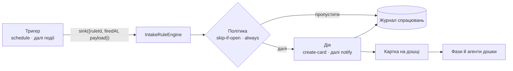

# Надходження задач

Як задачі потрапляють на дошки. Рішення — [ADR-0007](../../adr/0007-task-from-card-not-github-issue.md), [ADR-0015](../../adr/0015-intake-rules-and-audits.md).

## Джерела

| Джерело | Що робить | Код |
| --- | --- | --- |
| Нова картка (людина, агент) | Картка в першій фазі дошки, далі маршрути надходження | `packages/work-items/src/create-work-item.ts` |
| ClickUp | Опитування списків; таска → картка на дошці списку або за маршрутом | `packages/integration-clickup/src/poller.ts` |
| **Правила надходження** | Тригер спрацьовує → картка на вибраній дошці (див. нижче) | `packages/api/src/intake-rules/` |

**Маршрути надходження** (`intake-routes`) вирішують, *куди* лягає нова картка за умовою; **правила надходження** вирішують, *коли* Factory сама створює задачу.

## Правила надходження

Правило = **тригер** + **політика перекриття** + **дія**. Кожне — вид у реєстрі (`IntakeKindRegistry`), правило зберігає лише назву виду й JSON-конфіг.

- **Рушій** — `engine.ts`: `fire` (спрацювання → політика → дія → запис `done`/`skipped`/`failed`; власні помилки правила лише записуються), `sync` (тригер увімкнено/вимкнено відповідно до правила), `armAll` (під час старту), `validate`, `preview`, `present`.
- **Тригер `schedule`** — `schedule-trigger.ts`: один рядок core `Schedules` на правило (`schedule_factory-intake-rule-<id>`), воркфлоу `factory-intake-rule-fire` реєструється на Mastra в `MastraFactory.prepare()`; пресети (щодня, у будні, щотижня, кожні N год) або cron; часовий пояс IANA; опис словами й наступні запуски. Перетворення пресета в cron — `packages/core/src/intake/schedule.ts`.
- **Дія `create-card`** — `create-card-action.ts`: `createFactoryWorkItem` від імені автора правила (аудит — системний актор `factory-intake-rule:<id>`), далі перехід у вибрану фазу як правило. У метаданих картки: `description`, `repository` (за потреби), `intakeRule: { id, name, firedAt }`. Шаблони — `packages/core/src/intake/template.ts`.
- **Політики** — `policies.ts`: `skip-if-open` (типова), `always`.
- **Сховище** — `packages/store/src/intake-rules/base.ts`: `factory_intake_rules`, `factory_intake_rule_fires`.
- **API** — `routes.ts`, контракти — `packages/contracts/src/intake-rules.ts`: `GET …/intake-rules/kinds`, `POST …/preview`, CRUD, `GET …/:ruleId/fires`. Зміни — лише адмін організації; аудит `factory.intake_rule.*`.
- **UI** — `apps/ui/src/ui/domains/settings/intake-rules/`: редактор будується з видів, які повертає сервер, і форм із реєстру (`registerIntakeTriggerForm`, `registerIntakeActionForm`).

Як додати тригер, дію, політику — у [ADR-0015](../../adr/0015-intake-rules-and-audits.md#як-додати).
