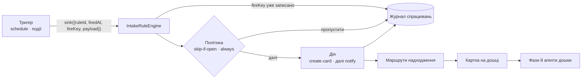

# Надходження задач

Як задачі потрапляють на дошки. Рішення — [ADR-0007](../../adr/0007-task-from-card-not-github-issue.md), [ADR-0015](../../adr/0015-intake-rules-and-audits.md), [ADR-0016](../../adr/0016-intake-rules-ports-and-adapters.md).

## Джерела

| Джерело | Що робить | Код |
| --- | --- | --- |
| Нова картка (людина, агент) | Картка в першій фазі дошки, далі маршрути надходження | `packages/work-items/src/create-work-item.ts` |
| ClickUp | Опитування списків; таска → картка за маршрутом або на дошці списку | `packages/integration-clickup/src/poller.ts` |
| **Правила надходження** | Тригер спрацьовує → картка за маршрутом або на дошці правила (див. нижче) | `packages/runtime/src/intake-rules/`, адаптери нижче |

**Маршрути надходження** (`intake-routes`) вирішують, *куди* лягає нова картка; **правила надходження** вирішують, *коли* Factory сама створює задачу. Рішення «куди» одне для всіх джерел — маршрути.

### Куди лягає нова картка (порядок)

1. Перший увімкнений маршрут, що реагує на «нова картка» і чия умова підходить (`resolveIntakePlacement`).
2. Інакше — ціль джерела: дошка List у ClickUp, дошка й фаза правила надходження (`defaultPlacement`).
3. Інакше — «Розробка», перша фаза.

Умови маршрутів можуть розрізняти картки правил: тип «картка правила надходження» (`source.kind = intake_rule`), «Правило» (`intake.rule`), «Тригер правила» (`intake.trigger`). Маршрут без умов забирає й картки правил.

## Правила надходження

Правило = **тригер** (коли) + **політика перекриття** (чи) + **дія** (що). Кожне — вид у своєму реєстрі; правило зберігає лише назву виду й JSON-конфіг.

### Шари

| Шар | Що | Код |
| --- | --- | --- |
| Домен і порти | Типи правила й спрацювання; порти `IntakeTriggerKind`, `IntakeActionKind`, `IntakePolicyKind`, реєстр, `IntakeRuleRepository`, `IntakeEventSource`; помилки `IntakeError`; схеми конфігів; факти походження картки | `packages/core/src/intake/` |
| Застосунковий сервіс | `IntakeRuleEngine`: `fire`, `validate`, `sync`, `armAll`, `preview`, `inspect`; політики; `eventTriggerKind` | `packages/runtime/src/intake-rules/` |
| Адаптер: дія `create-card` | Через `createFactoryWorkItem`; маршрути, потім ціль правила; ідемпотентно за `fireKey` | `packages/work-items/src/intake-create-card.ts` |
| Адаптер: тригер `schedule` | Рядок Mastra `Schedules` на правило (`schedule_factory-intake-rule-<id>`), воркфлоу `factory-intake-rule-fire`; `fireKey = schedule:<runId>` | `packages/server/src/intake/schedule-trigger.ts` |
| Корінь композиції | Реєструє конкретні види, будує рушій | `packages/server/src/intake/setup.ts` |
| Сховище | `factory_intake_rules`, `factory_intake_rule_fires` (з `fire_key`) | `packages/store/src/intake-rules/base.ts` |
| HTTP | Тонкі маршрути; `IntakeError` → 422/503 | `packages/api/src/intake-rules/routes.ts`, контракти `packages/contracts/src/intake-rules.ts` |
| UI | Редактор із видів сервера й форм із реєстру | `apps/ui/src/ui/domains/settings/intake-rules/` |

- **Спрацювання** — `fire`: якщо `fireKey` уже записано, повертає той запис; інакше політика → дія → запис `done`/`skipped`/`failed`. Власні помилки правила лише записуються, не кидаються.
- **Дія `create-card`** — від імені автора правила (аудит — системний актор `factory-intake-rule:<id>`). Метадані картки: `description`, `repository` (за потреби), `intakeRule: { id, name, triggerKind, firedAt, fireKey }`. Шаблони — `packages/core/src/intake/template.ts`.
- **Політики** — `skip-if-open` (типова): пропуск, поки картка попереднього спрацювання не в кінцевій фазі; `always`.
- **Події** — порт `IntakeEventSource` готовий, подійних тригерів ще немає (див. [беклог](../../changes/backlog.md)).
- **API** — `GET …/intake-rules/kinds`, `POST …/preview`, CRUD, `GET …/:ruleId/fires`. Зміни — лише адмін організації; аудит `factory.intake_rule.*`.

Як додати тригер, дію, політику, тип аудиту — у [ADR-0016](../../adr/0016-intake-rules-ports-and-adapters.md#як-додати).
