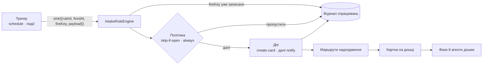

# Надходження задач

Як задачі потрапляють на дошки. Рішення — [ADR-0007](../../adr/0007-task-from-card-not-github-issue.md), [ADR-0015](../../adr/0015-intake-rules-and-audits.md), [ADR-0016](../../adr/0016-intake-rules-ports-and-adapters.md), [ADR-0020](../../adr/0020-intake-sources-and-routes.md).

Сторінка «Надходження задач» має дві частини: **Джерела** (звідки береться картка) і **Маршрути надходження** (куди вона йде й що з нею стається далі). Джерело нікуди картку не ставить.

## Джерела

| Джерело | Що робить | Код |
| --- | --- | --- |
| Нова картка (людина, агент) | Картка в першій фазі дошки, далі маршрути надходження | `packages/work-items/src/create-work-item.ts` |
| ClickUp | Опитування обраних списків; список лише прив'язаний до Factory. Імпортує задачу маршрут, що називає список (`source.list`); маршрут на «статус змінився» рухає картку | `packages/integration-clickup/src/poller.ts`, `status-routes.ts` |
| **За розкладом** (правила надходження) | Тригер спрацьовує → картка; ставить її маршрут «Розклад · <назва>», що з'являється з правилом | `packages/runtime/src/intake-rules/`, адаптери нижче |
| GitHub, GitLab | Issues і pull requests репозиторіїв Factory («Репозиторії») | `packages/integration-github`, `packages/integration-gitlab` |

**Маршрути надходження** (`intake-routes`) — один впорядкований список; вирішують, *куди* лягає нова картка і куди її переносить подія. **Правила надходження** вирішують лише, *коли* Factory сама створює задачу.

### Куди лягає нова картка (порядок)

1. Перший увімкнений маршрут з умовою, що реагує на «нова картка» і чия умова підходить (`resolveIntakePlacement`).
2. Інакше — ціль джерела: дошка й фаза правила надходження (`defaultPlacement`), якщо його маршрут видалили. Задачу ClickUp без маршруту, що називає її список, не імпортують.
3. Інакше — маршрут без умов, що бере будь-яку нову картку (`catchesEveryNewCard`). Кожен проєкт має такий маршрут за замовчуванням: «Усе інше йде у Розробка › Вхідні» (`CATCH_ALL_INTAKE_ROUTE`, додається раз у кінці списку; видалений не повертається). Його ціль можна змінити, щоб нові картки йшли на іншу дошку.
4. Інакше — перша фаза дошки за замовчуванням («Розробка»).

GitHub і GitLab кладуть нову картку в першу фазу «Розробки», а місце вирішують маршрути: дошка й фаза, які назвало правило інтеграції, не рахуються (лише `skipRules` ставить картку як є). ClickUp сам застосовує маршрути й позначає рішення `routesApplied`, тож диспетчер не переставляє його картку.

Умови маршрутів бачать будь-який факт картки: мітки, назву, автора, довіру, тип і інтеграцію джерела, а також `source.provider`, `source.repository` (репозиторій GitHub чи шлях проєкту GitLab), `source.list` (список ClickUp), `item.key` (`acme/app#42`), `item.state` (для ClickUp — статус задачі) і `item.assignees`. Рядки порівнюються без регістру; список (мітки, виконавці) підходить під `equals`/`in`, якщо підходить хоч один його елемент, а порожній список вважається відсутнім. Картки правил розрізняють тип «картка правила надходження» (`source.kind = intake_rule`), «Правило» (`intake.rule`), «Тригер правила» (`intake.trigger`).

### ClickUp: імпорт і статуси

- **Імпорт:** нова задача обраного списку імпортується, якщо увімкнений маршрут на «нова картка» називає її список (`source.list`) і його умова підходить; місце дає перший маршрут з умовою, що підходить (каталожний маршрут без умов не рахується). Маршрут, що не може взяти картку (дошки немає), — помилка в журналі опитувача, а не мовчазний пропуск.
- **Зміна статусу** (`work_item.state_changed`): перший маршрут на дошці картки на цю подію, чия умова підходить до нового статусу. Робоча фаза — лише поки картка там, куди її поставив попередній статус; кінцева — завжди (якщо картка ще не завершена). Задача зі статусом типу «closed»/«done» закриває картку за `sourceClosed` дошки.
- **Перенесення старих правил статусів** — `migrateListStatusRules` перед кожним проходом (раз на список, повторний прохід нічого не додає); відповідність — у [ADR-0020](../../adr/0020-intake-sources-and-routes.md).
- Редактор маршруту для умови «ClickUp List» показує «Коли спрацьовує»: нова задача / нова задача і зміна статусу / лише зміна статусу.

Маршрути за мітками (`/web/intake/label-routes`) прибрано (відповідь `410`); збережені маршрути ClickUp, GitHub і GitLab за мітками один раз переносяться в маршрути надходження під час запуску. Прив'язка джерела (`intake_source_bindings`) лише каже, який проєкт воно живить; дошку тримає тільки прив'язка, що її називає (список ClickUp, `Intake.bindingBoard`). Зміну маршрутів у налаштуваннях дозволено адміністраторам організації (`canEdit`), решта бачить їх лише для читання.

## Правила надходження

Правило = **тригер** (коли) + **політика перекриття** (чи) + **дія** (що). Кожне — вид у своєму реєстрі; правило зберігає лише назву виду й JSON-конфіг.

### Шари

| Шар | Що | Код |
| --- | --- | --- |
| Домен і порти | Типи правила й спрацювання; порти `IntakeTriggerKind`, `IntakeActionKind`, `IntakePolicyKind`, реєстр, `IntakeRuleRepository`, `IntakeEventSource`; помилки `IntakeError`; схеми конфігів; факти походження картки | `packages/core/src/intake/` |
| Застосунковий сервіс | `IntakeRuleEngine`: `fire`, `validate`, `sync`, `armAll`, `preview`, `inspect`; політики; `eventTriggerKind` | `packages/runtime/src/intake-rules/` |
| Адаптер: дія `create-card` | Через `createFactoryWorkItem`; маршрути, потім ціль правила; ідемпотентно за `fireKey` | `packages/work-items/src/intake-create-card.ts` |
| Адаптер: тригер `schedule` | Рядок Mastra `Schedules` на правило (`schedule_factory-intake-rule-<id>`), воркфлоу `factory-intake-rule-fire`; `fireKey = schedule:<runId>` | `packages/server/src/intake/schedule-trigger.ts` |
| Корінь композиції | Реєструє конкретні види, будує рушій | `packages/server/src/intake/setup.ts` |
| Адаптер: маршрут правила | `IntakeRuleRoutes`: при створенні правила — маршрут «Розклад · <назва>» (`intake.rule` = id → ціль дії); при видаленні — прибирає його | `packages/server/src/intake/rule-routes.ts` |
| Сховище | `factory_intake_rules`, `factory_intake_rule_fires` (з `fire_key`) | `packages/store/src/intake-rules/base.ts` |
| HTTP | Тонкі маршрути; `IntakeError` → 422/503 | `packages/api/src/intake-rules/routes.ts`, контракти `packages/contracts/src/intake-rules.ts` |
| UI | Редактор із видів сервера й форм із реєстру | `apps/ui/src/ui/domains/settings/intake-rules/` |

- **Спрацювання** — `fire`: якщо `fireKey` уже записано, повертає той запис; інакше політика → дія → запис `done`/`skipped`/`failed`. Власні помилки правила лише записуються, не кидаються.
- **Дія `create-card`** — від імені автора правила (аудит — системний актор `factory-intake-rule:<id>`). Метадані картки: `description`, `repository` (за потреби), `intakeRule: { id, name, triggerKind, firedAt, fireKey }`. Шаблони — `packages/core/src/intake/template.ts`.
- **Політики** — `skip-if-open` (типова): пропуск, поки картка попереднього спрацювання не в кінцевій фазі; `always`.
- **Події** — порт `IntakeEventSource` готовий, подійних тригерів ще немає (див. [беклог](../../changes/backlog.md)).
- **API** — `GET …/intake-rules/kinds`, `POST …/preview`, CRUD, `GET …/:ruleId/fires`. Зміни — лише адмін організації; аудит `factory.intake_rule.*`.

Як додати тригер, дію, політику, тип аудиту — у [ADR-0016](../../adr/0016-intake-rules-ports-and-adapters.md#як-додати).
