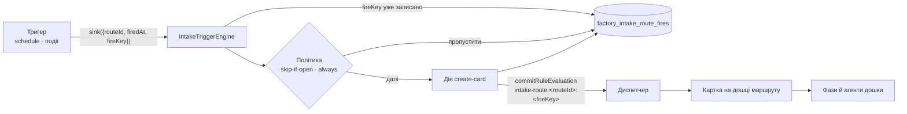

# Надходження задач

Як задачі потрапляють на дошки. Рішення — [ADR-0007](../../adr/0007-task-from-card-not-github-issue.md), [ADR-0020](../../adr/0020-intake-sources-and-routes.md), [ADR-0021](../../adr/0021-one-list-of-intake-routes.md) (замінює частини ADR-0015/0016/0020).

Сторінка «Надходження задач» має дві частини: **Джерела** — лише підключення, і **Маршрути надходження** — один впорядкований список, що вирішує все інше.

## Джерела

| Джерело | Що це | Код |
| --- | --- | --- |
| ClickUp | Підключення й перемикач «Імпортувати задачі ClickUp». Factory читає ті Lists, які називають її маршрути (умова «ClickUp List», `source.list`) | `packages/integration-clickup/src/poller.ts`, `lists.ts` |
| GitHub, GitLab | Issues і pull requests репозиторіїв Factory (налаштовуються в «Репозиторіях») | `packages/integration-github`, `packages/integration-gitlab` |
| Нова картка | Людина чи агент створює картку на дошці | `packages/work-items/src/create-work-item.ts` |

## Маршрути надходження

Кожен маршрут — **«Коли» + умови → куди**. «Коли» буває двох видів:

1. **Надходить картка з джерела.** Умови: мітки, назва, автор і довіра, тип і інтеграція джерела, `source.provider`, `source.repository`, `source.list` (List ClickUp), `item.key`, `item.state` (статус задачі ClickUp), `item.assignees`; для подій — `event.type`, `event.reason`. Маршрут каже, які події обробляє (`on`): `work_item.created` ставить нову картку, решта переносить наявну (задачу закрито / перевідкрито / статус змінився, події PR).
2. **За розкладом (повторюється).** Маршрут має свій тригер (`trigger`: розклад і часовий пояс), дію (`action`: `create-card` — назва з `{date}`/`{time}`/`{route}`, опис, репозиторій) і політику перекриття (`policyKind`: `skip-if-open` — типова, `always`). На кожне спрацювання сам створює картку у своїй дошці › фазі. Умов і подій не має; у порядку для карток, що надходять, участі не бере. У списку — позначка «Розклад», найближчий і останній запуск, історія спрацювань.

### Редактор: джерело, подія, умови

«Коли» в редакторі — **джерело** (будь-яке, ClickUp, GitHub, GitLab, «GitHub або GitLab», вручну) або «За розкладом». Джерело обирається один раз; окремої умови «Джерело» немає. Далі — **подія** (лише ті, що це джерело надсилає: для ClickUp — нова задача, статус змінився, задачу закрито; для GitHub/GitLab — нова issue чи PR, закрито / перевідкрито, події PR) і, для «задачу закрито», як закрито. **Умови** — лише поля цього джерела (ClickUp: List, статус зі статусів самого List, тег, виконавець, назва; GitHub/GitLab: репозиторій, тип, автор, мітка, назва, виконавець; будь-яке й вручну: назва, тег).

- **Опис джерела** — `IntakeSourceDescriptor` у `packages/core/src/boards/intake-sources.ts`: `{ id, integrations?, events, fields, impliedBy? }`, реєстр `defineIntakeSource` / `intakeSource` / `intakeSources`. Новий трекер (Jira, Linear) — один опис і переклади (`intakeRoutes.sources.<id>`, за потреби `sourceEvents` / `sourceFields`); редактор, підсумок рядка й читання збережених маршрутів не змінюються.
- **Зберігання не змінилося.** Джерело — умова `source.integration` (`equals` / `in`, `not_exists` для карток, створених у Factory) або її відсутність («будь-яке»). Маршрут без неї читається як джерело, на яке вказують його поля чи події (`source.list` → ClickUp, подія PR → GitHub або GitLab — `readIntakeSource`), і записується назад без неї: відкрити й зберегти маршрут — те саме, що нічого не робити (перевірено для кожного стандартного маршруту й маршрутів статусів ClickUp).
- **Підсумок рядка:** джерело · умови · усі події — «ClickUp · Syncta / Bugs · статус «to do» · нова задача або статус задачі змінився → Розробка › Розбір».
- Маршрут з умовою, яку редактор не показує (OR, вкладені групи, інші поля й оператори), зберігає умову й події як є; змінюються лише назва й куди.

### Куди лягає нова картка (порядок)

1. Перший увімкнений маршрут (не за розкладом), що реагує на «нова картка» і чия умова підходить (`resolveIntakePlacement`).
2. Інакше — маршрут без умов, що бере будь-яку нову картку (`catchesEveryNewCard`); за замовчуванням «Усе інше йде у Розробка › Вхідні» (`CATCH_ALL_INTAKE_ROUTE`, додається раз; видалений не повертається).
3. Інакше — перша фаза дошки за замовчуванням («Розробка»).

Кожне надходження ставить диспетчер однією функцією ядра `placeArrival` — і GitHub/GitLab, і ClickUp. Надходження може попросити `routing.skipCatchAll` (лише маршрут з умовою, як для задачі ClickUp, яку підписав її List) і `routing.holdAtInitialPhase` (на дошку маршруту, але в її першу фазу: задача, що існувала до старту сервера, нічого не запускає). Картка, що вже має штамп маршруту (`intakeRouteId`, напр. картка маршруту за розкладом), лишається, де її поставили. ADR-0022.

### ClickUp

- **Які Lists читає:** названі маршрутами Factory (`routedClickUpLists` ← `routedSourceScopes(routes, 'source.list')` з core). List, названий маршрутами двох Factory, читається для кожної.
- **Імпорт:** опитувач вирішує лише підписку — увімкнений маршрут на «нова картка», що називає List задачі (`equals`/`in`) і чия умова підходить (`routeSubscribesSource`); куди лягає картка, вирішує диспетчер (див. вище). Задача, чий маршрут уже не може її поставити, лягає в першу фазу дошки за замовчуванням.
- **Зміна статусу:** опитувач оновлює метадані картки й комітить `routeEvent` з `work_item.state_changed`; маршрут застосовує диспетчер (`#routeEvent`): чекає запуску агента на картці (крім переходу в кінцеву фазу), пише маршрут в історію. Подія йде, лише поки картка там, куди її поставив попередній статус; статус, чий маршрут завершує картку, — завжди.
- **Закриття** (тип статусу «closed/done»): `transition` з подією `work_item.closed` (`reason: completed`) і закриттям дошки (`sourceClosed`) як запасним ходом: маршрут на «задачу закрито» має перевагу.
- **Дошка картки** — з `projectBoards.load` (збережені дошки теж).
- **Старі правила статусів** List (імпорт / фаза / закрити / ігнорувати) переносить `ClickUpIntegration.migrate` раз на старті: маршрути з фіксованим id і `origin` (`clickup-status`); див. ADR-0020, ADR-0021.

### GitHub (і що лишилось GitLab)

- **Підписка — маршрути.** Репозиторій, який читає проєкт, — GitHub-маршрут з `source.integration = github` і `source.repository = <owner/repo>` (`routedSourceScopes(routes, 'source.repository', 'github')`). Перемикач організації «GitHub увімкнено» (`intake config enabled`) лишається загальним вимикачем.
- **Ручна стрічка «Вхідних»** — окрема можливість: дошка показує issues прив'язаних репозиторіїв, які названо маршрутами, і людина бере їх руками (`useBoardIntake`). PR дошка «Розробка» й далі показує з усіх прив'язаних репозиторіїв.
- **Режим токена:** опитування подає issues лише репозиторіїв, названих маршрутами (`GithubTokenIntegration.issueSweepRepositories`).
- **Посилання репозиторію** на сервері додає його маршрут (`subscribeLinkedRepository`, `server/src/intake/repository-subscriptions.ts`): перед «усім іншим», з його ціллю (картка лягає туди ж), фіксований id, `origin: { kind: 'repository' }`.
- **Міграція** `intake.githubRepositorySelections.v1`: старий вибір організації (`sourceIds` — id або повна назва) → маршрут на кожен вибраний прив'язаний репозиторій кожного проєкту.
- **GitLab** поки підписується вибором `sourceIds` і прив'язками (`intake_source_bindings`): не переведено, див. ADR-0022 і беклог.

### Разові міграції старту

`packages/server/src/migrations/`: `factoryBootMigrations` — один впорядкований список зі сталими версійними id; `runBootMigrations` виконує невиконані, записує позначку в `factory_boot_migrations` і для кожної знає політику збою (зупинити старт / попередити / вимкнути інтеграцію). Нова міграція — у кінець списку з новим id; завершену не правити.

### Назви маршрутів

Маршрути, які пише Factory, зберігають `origin` з `generatedName`; UI показує локалізовану назву (напр. «ClickUp: статус «to do»»), доки людина не перейменує маршрут. Стандартні маршрути перекладаються за назвою (`DEFAULT_ROUTE_NAMES`).

## Маршрути за розкладом: як це працює

| Шар | Що | Код |
| --- | --- | --- |
| Домен і порти | `IntakeTriggerRoute`, `IntakeRouteFire`; порти `IntakeTriggerKind`, `IntakeActionKind`, `IntakePolicyKind`, реєстр, `IntakeTriggerRouteRepository`, `IntakeEventSource`; помилки; схеми конфігів; `routeSubscribesSource`, `routedSourceLists`, `isTriggerRoute` | `packages/core/src/intake/`, `packages/core/src/boards/intake-routing.ts` |
| Застосунковий сервіс | `IntakeTriggerEngine` (`fire`, `validate`, `sync`, `remove`, `armAll`, `preview`, `inspect`); політики; `eventTriggerKind` | `packages/runtime/src/intake-triggers/` |
| Адаптер: дія `create-card` | Картка через `commitRuleEvaluation`, джерело `intake-route` / `<routeId>:<fireKey>` | `packages/work-items/src/intake-create-card.ts` |
| Адаптер: тригер `schedule` | Рядок Mastra `Schedules` на маршрут, воркфлоу `factory-intake-route-fire`, `fireKey = schedule:<runId>` | `packages/server/src/intake/schedule-trigger.ts` |
| Репозиторій | Маршрути з `StoredBoardsStorage`, журнал з `IntakeRouteFiresStorage` | `packages/server/src/intake/repository.ts`, `packages/store/src/intake-route-fires/base.ts` |
| Корінь композиції | Єдине місце, що називає конкретні види | `packages/server/src/intake/setup.ts` |
| Міграція | Правила надходження → маршрути за розкладом | `packages/server/src/intake/migrations.ts` |
| HTTP | `/intake-routes` (з `triggered`), `/kinds`, `/preview`, `/:routeId/fires`; `IntakeError` → 422/503 | `packages/api/src/intake-routes.ts`, `packages/contracts/src/intake-triggers.ts` |
| UI | Редактор маршруту з «Коли»; форми видів із реєстру | `apps/ui/src/ui/domains/settings/components/IntakeRoutesSection.tsx`, `…/settings/intake-triggers/` |

Зміни маршрутів дозволені адміністраторам організації (`canEdit`); аудит `factory.intake_route.*`. Як додати тригер, дію, політику чи трекер — у [ADR-0021](../../adr/0021-one-list-of-intake-routes.md#як-додати).
