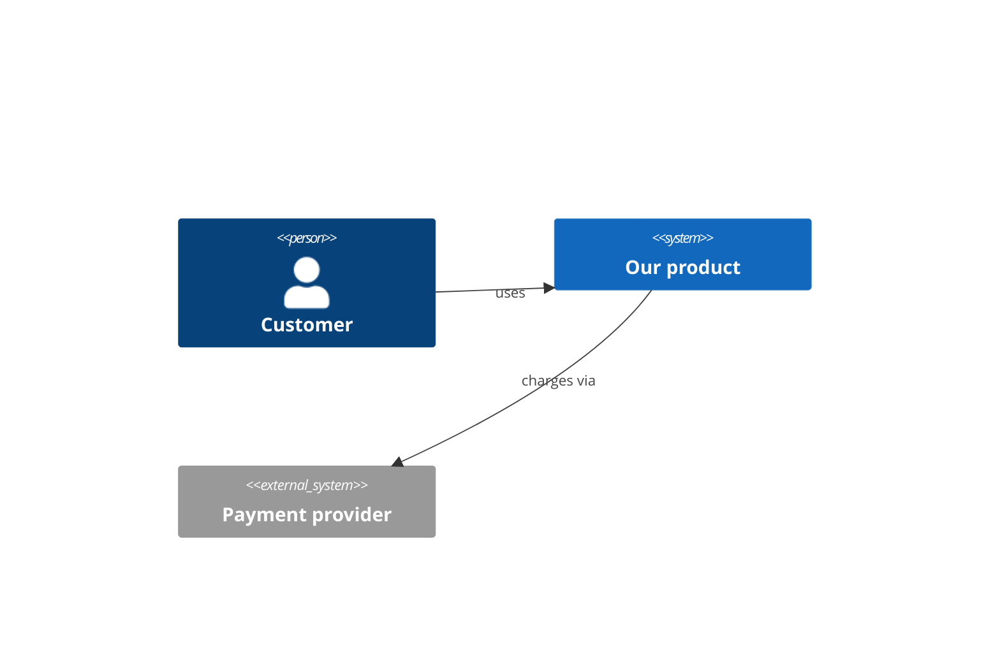
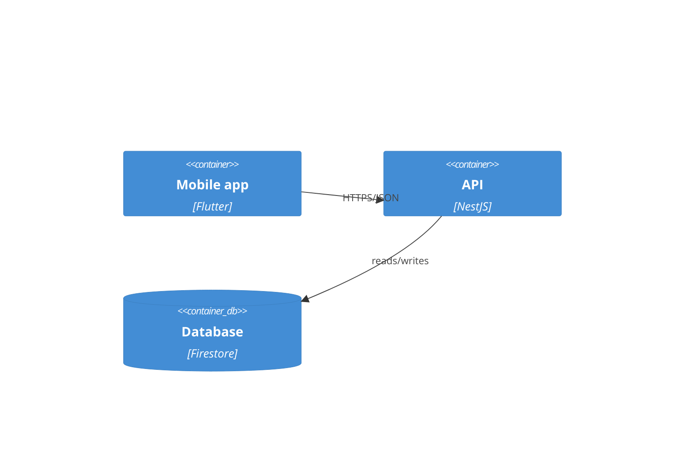
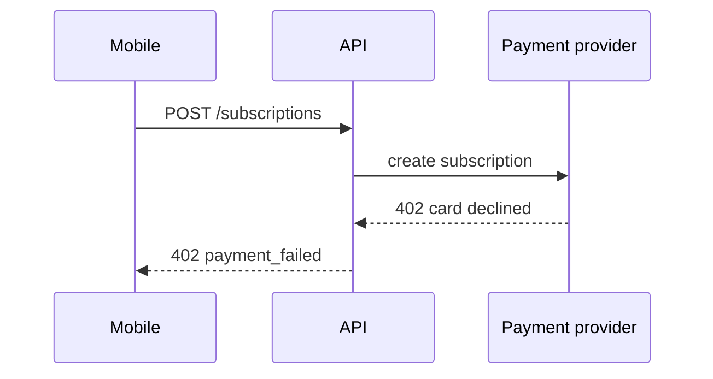
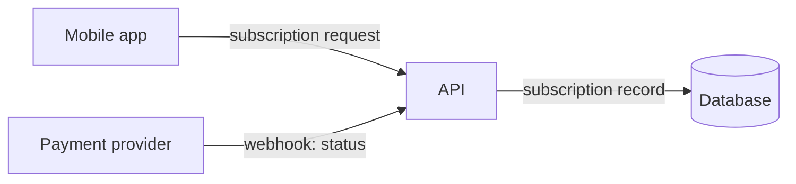

# design.md template (the technical spec)

Path: `<docs>/specify/<feature>/design.md`. Audience: the team. Prescriptive: what *will be* built; the descriptive "what is" lives in the project's other documents. Fixed shape, so a reviewer can check completeness **without asking the author**: adapt wording, not structure. Fill every section: `None` when it does not apply, `Open question: <what>` when the source does not say.

Write it in the person's language. Keep these headings or the Ukrainian ones in brackets: `factory_check_product_document` (`type: spec`) requires Architecture, Sequences, Data flow, Modules touched, API contract, Data model, Security, Shared resources, Test plan, Decisions, Consult round, Premortem outcome and Open questions, plus a `C4Context` or `C4Container`, a `sequenceDiagram` and a `flowchart` Mermaid block.

`````markdown
# <Feature>: design

revision: 1 · status: draft · brief: requirements.md (revision <n>) · research: research.md
builds on: <AGENTS.md / CLAUDE.md>, <docs/README.md>, <earlier design.md files>, <adr/…>

## Architecture  (Архітектура)
<!-- C4 context (people and systems) and/or container (apps, services, databases) level; names as earlier documents use them. New elements marked. -->




## Sequences  (Послідовності)
<!-- One per main use case of the brief (UC-n), including the failure paths that matter. -->


## Data flow  (Потік даних)


## Modules touched  (Модулі, що змінюються)
| Repository | Module / package | Layer | Change |
|---|---|---|---|
| acme/api | src/subscriptions | application | new module |
| acme/mobile | features/subscriptions | domain, data, presentation | new |

## API contract  (API-контракт)
| Method | Path | Auth | Request DTO | Response DTO | Errors |
|---|---|---|---|---|---|
| POST | /subscriptions | user | CreateSubscriptionDto | SubscriptionDto | 400 validation, 401, 402 payment_failed, 409 already_active |

### DTOs
<!-- Field lists with type, nullability, validation; one block per DTO. Shapes only, no code. -->

### Error contract
<!-- The shape of an error response; which codes each client must handle and how. -->

### Events
<!-- Webhooks, queues, domain events: name, producer, consumers, payload fields. "None" if none. -->

## Data model  (Модель даних)
| Entity | Collection / table | Fields (type, nullable) | Relationships | Indexes |
|---|---|---|---|---|

### Migration / backfill
<!-- Needed? What runs, in what order, reversible or not. Irreversible → the owning task is `gate: human`. -->

## Security  (Безпека)
- Identity: <how it is established on every request; which claims are used; where the role comes from — a trusted claim, never the body>
- Authorization: <per endpoint, who may call it>
- BOLA / IDOR: <for every user- or company-scoped path, the server-side filter that makes another owner's record unreachable>
- Client bundle: <nothing privileged shipped to the client>
- Input, rate limits, logging: <validation on every endpoint; limits on auth, expensive and enumeration-prone endpoints; no secrets or PII in logs>

## Shared resources  (Спільні ресурси)
<!-- Schema, auth, design tokens, shared widgets: each named once; each becomes ONE foundation task in tasks.md that every consumer depends on. -->
| Resource | Owning task | Consumers |
|---|---|---|

## Non-functional requirements  (Нефункціональні вимоги)
<!-- Only those that matter here: latency / cold-start budget, offline, observability (what is logged, what alerts), limits. -->

## UI  (Інтерфейс)
<!-- Omit for backend-only features. -->
- Design source: <design file / screen @ revision, or "a design task produces it">
- Tokens → widgets: <existing theme tokens only; new tokens go through the design system, never inline values>
- Responsive / adaptive: <what changes at each breakpoint>
- Navigation: <routes added; deep links>
- States: <empty / loading / error / offline / permission denied, per the brief's edge cases>

## Test plan  (План тестування)
**Seams:** <where the feature is tested from: the highest seams possible, existing ones preferred; confirmed with <person>>
**What a good test is here:** external behaviour only, not implementation details.
**Prior art:** <similar tests already in the codebase, with paths>

| Scenario | Kind (black-box / integration / contract / e2e) | Seam | Covers (UC / AC) | Data |
|---|---|---|---|---|
| A declined card shows "Payment failed" and no access is granted | e2e | mobile → API | UC-1, AC-3 | test card 4000…0002 |

Every acceptance criterion of the brief appears in *Covers* at least once.

## Decisions  (Рішення)
### ADR-1 — <decision title>
- Context: <one line>
- Decision: <one line>
- Consequences: <one line, including what becomes hard>
- Record: <adr/000N-… when it outlives the feature, or "local">

### Rules  (Правила)
<!-- Every rule in <docs>/rules/ this feature falls under, answered. A rule that asks questions before a feature (e.g. critical questions) gets each question answered here, pointing at the test scenario or section that covers it; "does not apply, because …" is an answer, silence is not. -->
| Rule | Item | Answer | Covered by |
|---|---|---|---|
| rules/<file>.md | <question / requirement> | <answer> | <test-plan scenario / section> |

## Consult round  (Консультаційний раунд)
| Lens | Verdict | Change made / open question |
|---|---|---|
| Backend: contract and data | Agree / Object | <specific change, e.g. "DTO missing ownerId; added, filtered server-side"> |
| Mobile | | |
| Web / landing | | |
| Security | | |
| Design | | <or "skipped — no UI"> |

## Premortem outcome  (Результат премортему)
**Verdict:** <sound as-is / sound after the must-handles / needs a rethink>
**Lenses run:** <which, and which skipped and why>
- Must handle now (folded in): <finding — the structural reason — the section it changed>
- Safe to defer: <title — one line>
- Explicitly out of scope: <title — one line>

## Open questions  (Відкриті питання)
- <question> — who answers it — blocks: <sections / tasks, or "none">
`````
